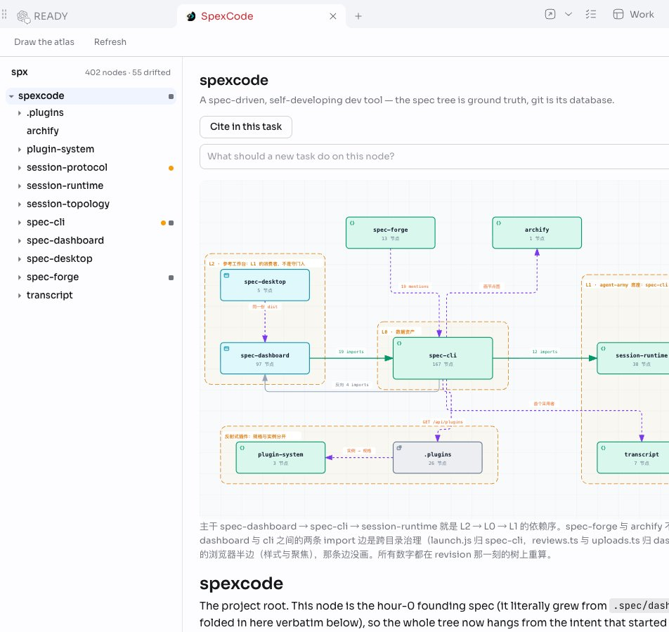
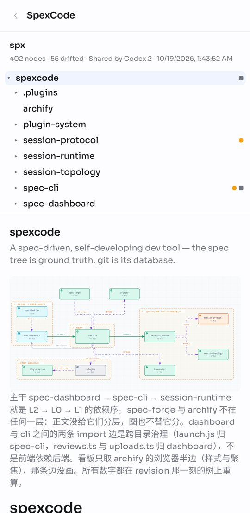

# SpexCode for gugu

The spec tree of the repository a gugu task works in, beside that task: every node of `.spec/`, which ones drifted
from the code they govern, each node's body and its architecture diagram. It is the same tree `spex graph` assembles.

- **Beside any task.** Add the SpexCode tab next to a task. If the task runs on another of your computers, the tree
  is read on that computer.
- **Work goes to gugu.** "Start here" starts a new task on a node with your words; "Cite" puts `[[node]]` in this
  task's composer; "Draw the atlas" starts a task that draws the diagrams.
- **Agents get SpexCode's skills**: find the spec of a file, change code and spec together, lint, and the
  repository's local issues.
- **Share with a group.** Ask an agent in the group to share the tree. It puts `<project>.spexcode` into the group's
  files, and anyone there opens it with SpexCode, read-only, on a computer or a phone. Sharing again updates that file.

SpexCode runs through `npx` (Node.js 22 or newer), pinned to the version of this App. Nothing is installed or
configured in your repository. Source: [shuxueshuxue/Spexcode](https://github.com/shuxueshuxue/Spexcode).
